# Documentación del uso de IA

## Colorfly Studio - Proyecto M1

**Autor:** Frederick Bermúdez  
**Fecha:** Octubre de 2026  
**Proyecto desplegado:** [Colorfly Studio](https://the-killing-joke.github.io/ProyectoM1_Frederick/)  
**Versión en PDF:** [PROMPTS.pdf](./PROMPTS.pdf)

---

## Propósito y forma de trabajo

Desde el inicio pedí que la IA funcionara como guía y no como sustituto de mi trabajo. Por eso el proceso se construyó por pasos: propuse objetivos, escribí y probé el código, compartí errores o resultados y pedí explicaciones antes de continuar.

Cada apartado conserva una cita breve de mi consulta, una cita de la orientación recibida, un comentario sobre la decisión que tomé y la evidencia visual de la conversación.

## Recorrido documentado

1. Acuerdo inicial de acompañamiento.
2. Estructura de las paletas temáticas.
3. Refactorización y variables CSS.
4. Copiado de colores y etiquetas accesibles.
5. Cambio de formato entre HEX y HSL.
6. Revisión de accesibilidad en el efecto de copiado.
7. Distribución responsive de las paletas.
8. Bloqueo de colores e historial local.
9. Validación de colores bloqueados.

---

## 1. Acuerdo inicial de acompañamiento

### Mi consulta

> “No quiero que hagas mi proyecto por mí, quiero que me guíes para yo hacerlo.”

### Orientación recibida

> “La idea es que tú construyas el proyecto y yo funcione como tu guía, profesor y compañero de desarrollo.”

### Decisión y aporte al proyecto

Desde el inicio definí que quería aprender mientras desarrollaba Colorfly Studio. Por eso trabajé cada funcionalidad de forma gradual: recibía una explicación, escribía el código, lo probaba y continuaba cuando entendía qué estaba haciendo.

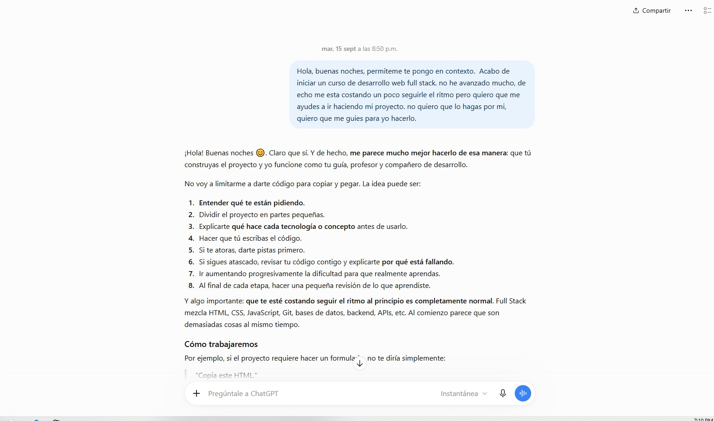

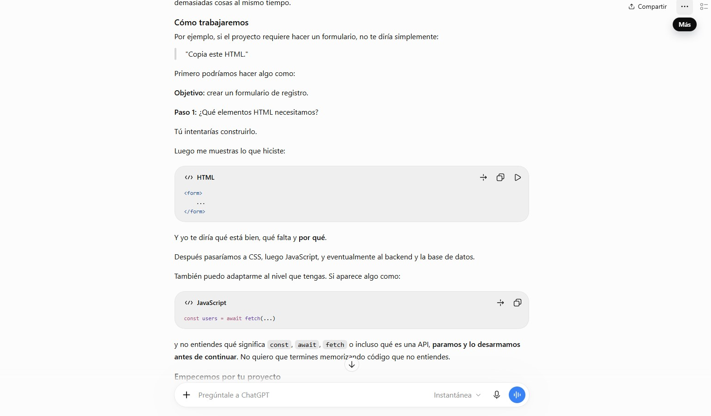

---

## 2. Estructura de las paletas temáticas

### Mi consulta

> “Quiero que cada paleta sea objeto con información, que por ejemplo diga ‘colores tierra’, una breve descripción de esa paleta y en qué se suelen usar esos colores.”

### Orientación recibida

> “Usaremos un array de objetos.”

> “Un objeto mantiene asociada toda la información de una misma paleta.”

### Decisión y aporte al proyecto

Quise que las paletas temáticas no fueran solo listas de colores. A partir de esta conversación organicé `paletasDisponibles` como un array de objetos con `nombre`, `descripcion`, `usos` y `colores`. Así pude mostrar información útil junto a cada paleta temática y mantener relacionados todos sus datos.

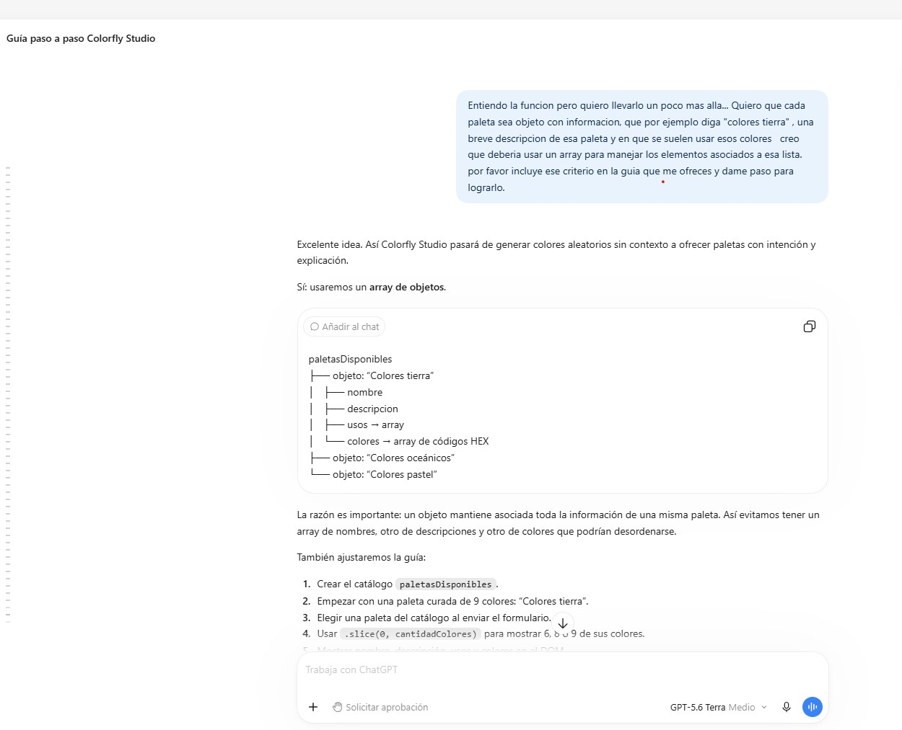

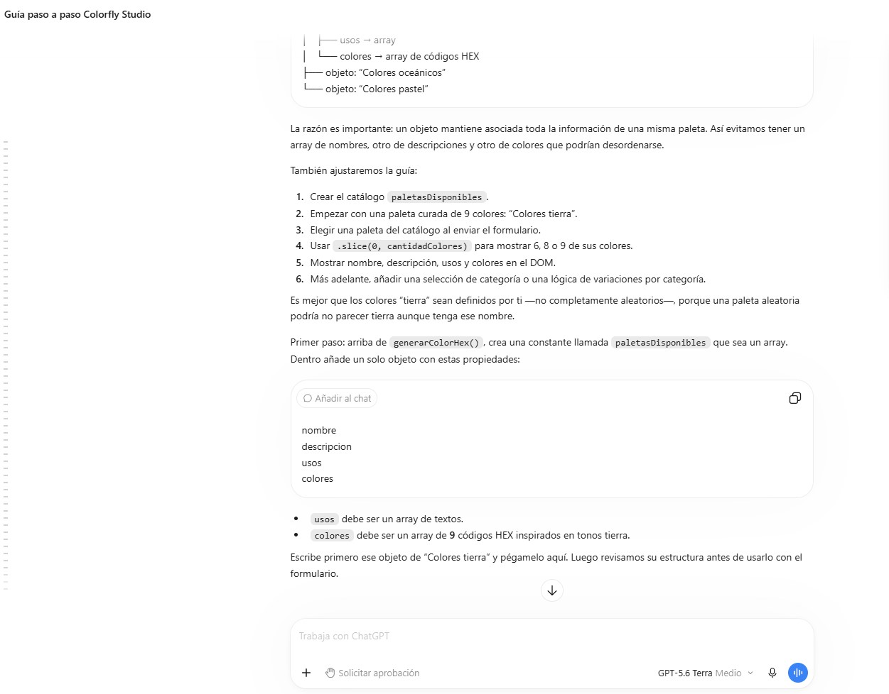

---

## 3. Refactorización y variables CSS

### Mi consulta

> “He creado los estilos uno a uno a medida que voy creando los elementos. Eso ha causado que algunas clases sean exactamente igual pero con un nombre distinto.”

> “Quiero mejorar la estructura del código CSS para que sea más mantenible y optimizado, usar una root para definir los colores y elementos que se usarán más adelante.”

### Orientación recibida

> “Lo haremos como una refactorización: mejoraremos la organización sin cambiar el resultado visual ni romper el JavaScript.”

> “Primero centralizaremos valores repetidos, luego agruparemos estilos compartidos y, al final, sustituiremos selectores CSS de `id` por clases cuando corresponda.”

### Decisión y aporte al proyecto

Antes de añadir más funcionalidades, organicé el CSS. Definí variables dentro de `:root` para colores, bordes, radios y sombras. También conservé los `id` que usaba JavaScript y añadí clases cuando era necesario reutilizar estilos. Esto hizo que el código fuera más fácil de mantener sin afectar la lógica existente.

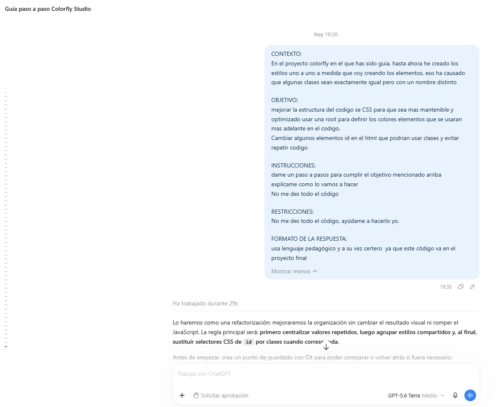

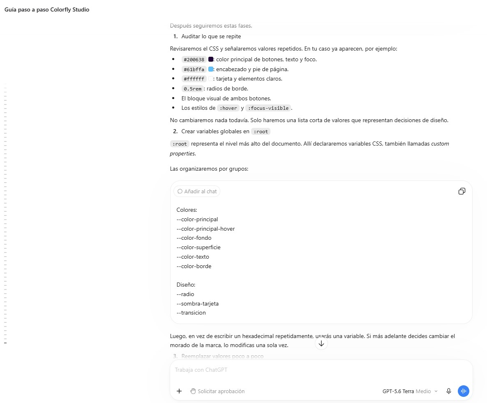

---

## 4. Copiado de colores y etiquetas accesibles

### Mi consulta

> “Quiero poder hacer clic en cada uno de los colores mostrados y que se copie el texto del color en el portapapeles.”

### Orientación recibida

> “Cada código puede convertirse en un botón y usar una función reutilizable para copiar el color.”

> “El botón debe incluir un `aria-label` como: ‘Copiar el código de color #1B3323’.”

### Decisión y aporte al proyecto

Convertí el código de cada color en un botón. Al hacer clic, uso la API del portapapeles para copiar el valor. También añadí etiquetas accesibles para que un lector de pantalla anuncie qué color se copiará antes de activar el botón.

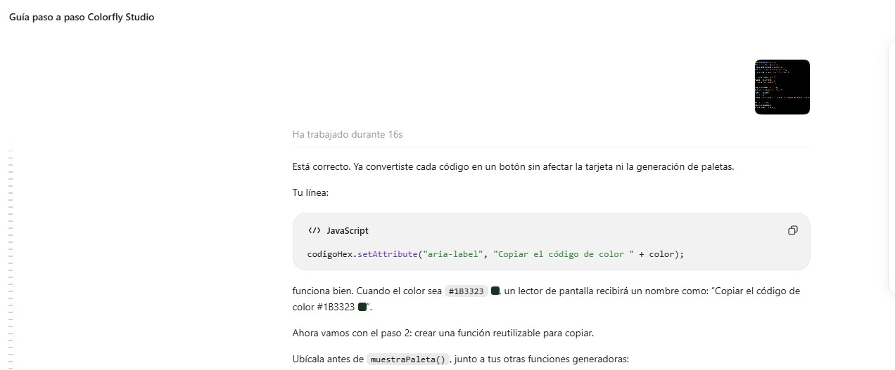

---

## 5. Cambio de formato entre HEX y HSL

### Mi consulta

> “Quiero que al activar el toggle se cambie el formato de color mostrado en ese momento por el nuevo formato.”

> “Pienso que debería crear dos funciones, una de HEX a HSL y una de HSL a HEX, y luego crear un event listener que cambie de una a la otra.”

### Orientación recibida

> “La idea es correcta, con una mejora importante: guardar en JavaScript los colores que están actualmente en pantalla.”

> “No conviene convertir leyendo el texto de cada botón del DOM. El arreglo en JavaScript será la fuente confiable de datos.”

### Decisión y aporte al proyecto

Creé el arreglo `coloresEnPantalla` para guardar el estado de la paleta visible. Implementé las funciones de conversión entre HEX y HSL y usé el evento `change` del toggle. De esta forma, la paleta se vuelve a renderizar en el formato seleccionado sin perder los colores actuales.

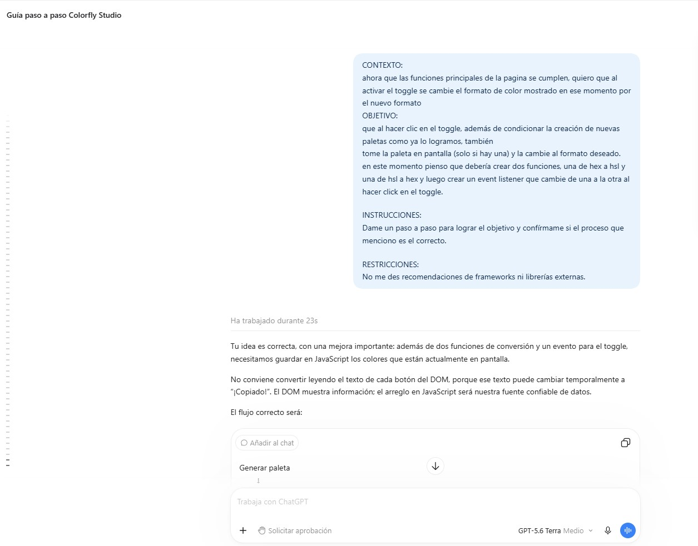

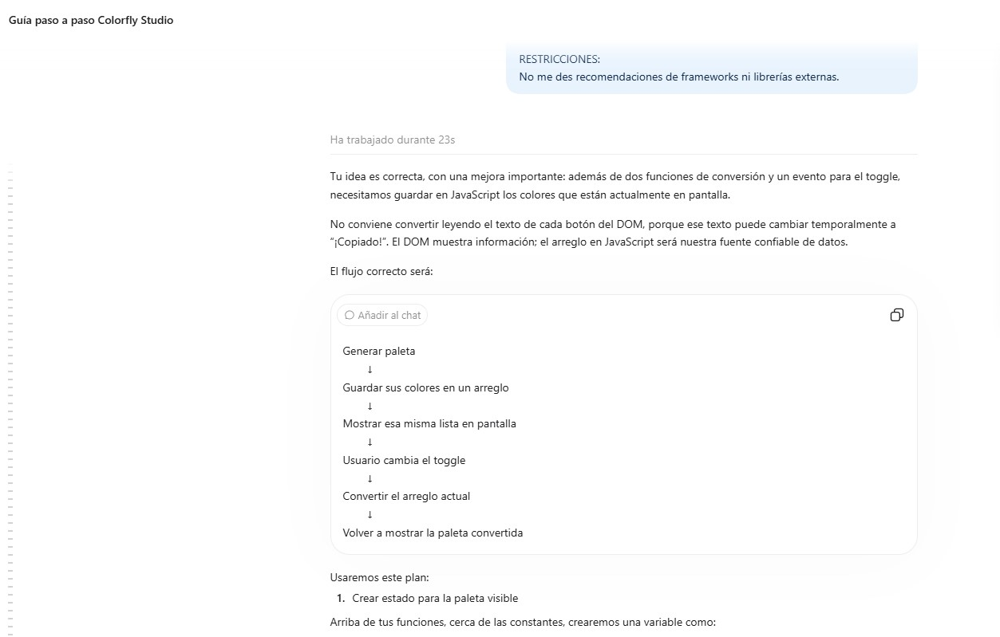

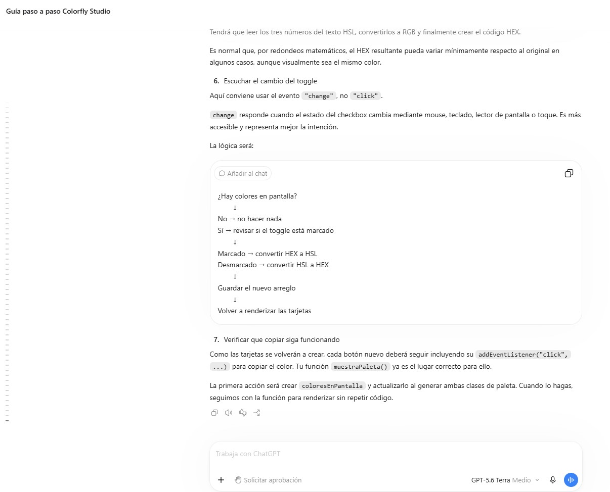

---

## 6. Revisión de accesibilidad en el efecto de copiado

### Mi consulta

> “Si aplico este tipo de cambios a mi CSS, ¿el asistente de voz aún leería el código HEX a copiar a personas con discapacidad?”

### Orientación recibida

> “El lector de pantalla seguirá anunciando el código correctamente porque el texto continúa dentro del botón y el `aria-label` describe la acción.”

> “Sería problemático usar `display: none`, porque eliminaría el elemento del árbol de accesibilidad.”

### Decisión y aporte al proyecto

Quise que el efecto visual de mostrar “Copiar” al pasar el mouse no perjudicara la accesibilidad. Mantuve el código dentro del botón y usé estilos visuales sin ocultar el contenido para tecnologías de asistencia.

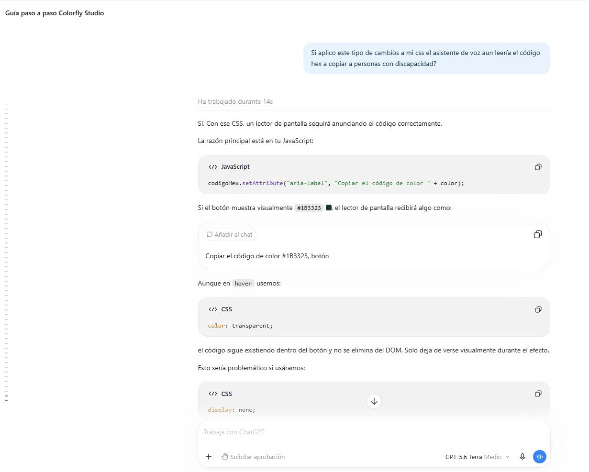

---

## 7. Distribución responsive según la cantidad de colores

### Mi consulta

> “Los cuadrados a mostrar deberían ser 3 filas de 3 si seleccionan 9, 2 de tres si seleccionan 6 y 2 de 4 si seleccionan 8.”

> “La de 8 colores se puede ver muy junta en teléfonos o pantallas pequeñas.”

### Orientación recibida

> “Usaremos la cantidad real de colores para colocar un atributo dinámico en la lista y CSS decidirá cuántas columnas usar.”

> “La paleta de 8 puede usar cuatro columnas en pantallas grandes y dos columnas mediante una media query en pantallas pequeñas.”

### Decisión y aporte al proyecto

Definí distribuciones diferentes para 6, 8 y 9 colores. Desde JavaScript asigné `data-cantidad` a la lista de colores y desde CSS configuré la cuadrícula según esa cantidad. También añadí una media query para que la paleta de ocho colores pase a dos columnas en pantallas pequeñas.

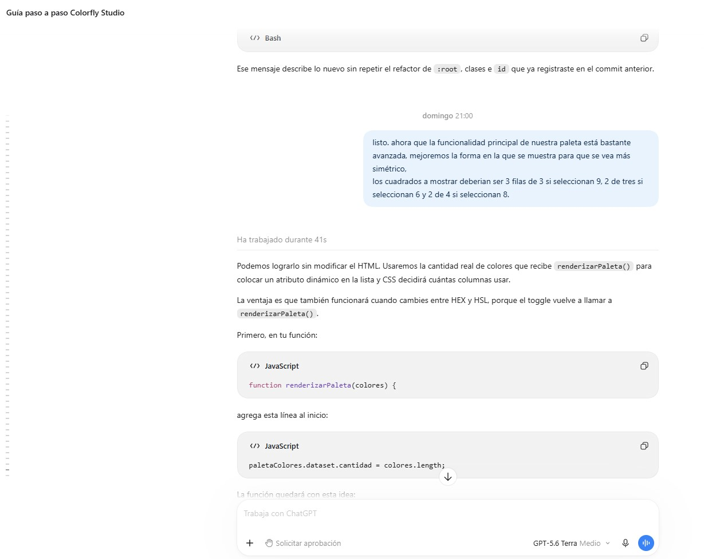

---

## 8. Bloqueo de colores e historial local

### Mi consulta

> “Para conseguir puntos extras la consigna muestra ‘bloqueo de colores y guardado de paletas en local storage’.”

> “Para el guardado en local storage estaba pensando hacer una barra de historial que muestre las paletas generadas.”

### Orientación recibida

> “El bloqueo de colores significa conservar determinados colores al generar una nueva paleta.”

> “Podemos usar un `Set` para guardar las posiciones bloqueadas y un `aside` para organizar el historial de paletas.”

### Decisión y aporte al proyecto

Implementé botones de bloqueo dentro de cada tarjeta de color y utilicé `posicionesBloqueadas` como un `Set`. Los colores bloqueados se conservan cuando genero otra paleta. También añadí un historial lateral con `localStorage`, desde el cual puedo cargar, eliminar o limpiar paletas guardadas.

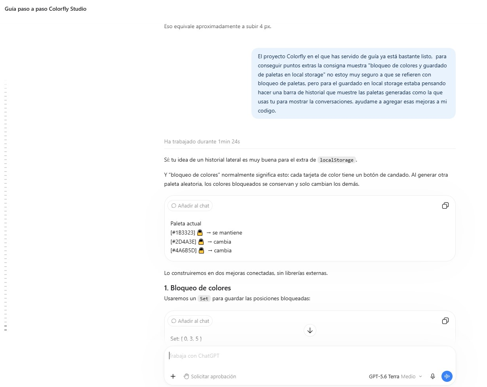

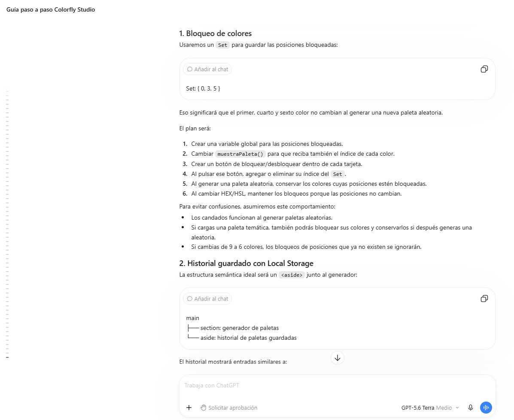

---

## 9. Validación de colores bloqueados

### Mi consulta

> “Quiero que el color bloqueado o colores bloqueados se muestren en pantalla. Movamos los colores bloqueados a las primeras posiciones de la lista para que de esta forma no se pierdan.”

> “Quiero que salga un mensaje de error si la cantidad de colores bloqueados es mayor que la cantidad de colores seleccionados. La paleta debe quedarse exactamente como está.”

### Orientación recibida

> “Los bloqueos deben seguir al color, no quedarse asociados a una posición fija.”

> “Si hay más colores bloqueados que la cantidad solicitada, no debemos generar nada ni modificar la paleta actual.”

### Decisión y aporte al proyecto

Primero modifiqué la lógica para extraer los colores bloqueados y colocarlos al inicio de la nueva paleta. Después añadí una validación antes de generar otra paleta. Si la cantidad de bloqueos supera la cantidad elegida, la paleta visible se conserva y aparece un mensaje temporal con `role="alert"`.

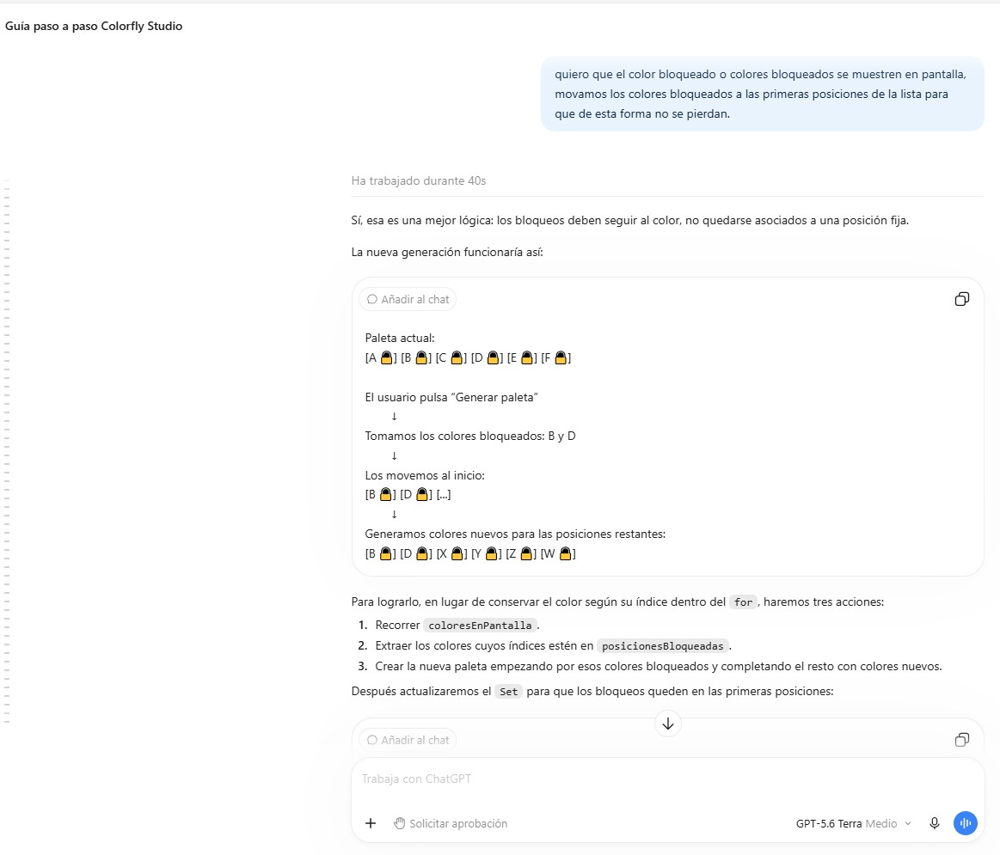

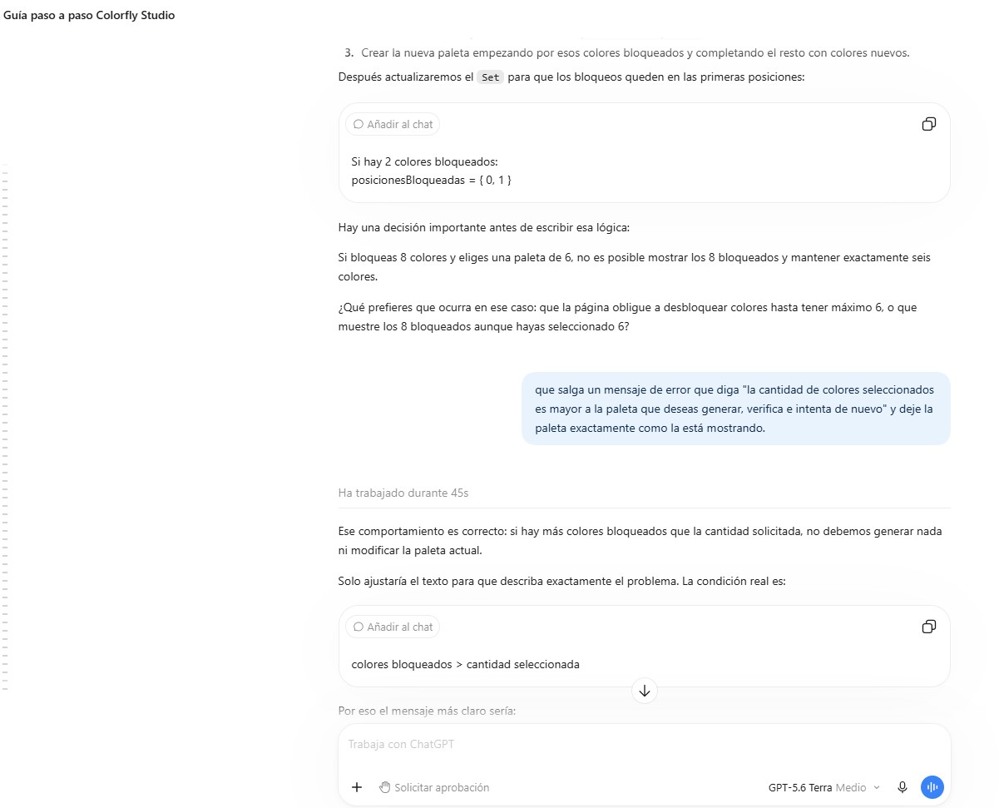

---

## Cierre

Usé IA como apoyo para aprender, organizar decisiones técnicas y resolver dudas puntuales durante el desarrollo de Colorfly Studio. Las conversaciones muestran un proceso iterativo: propuse ideas, recibí una explicación, escribí el código, probé los resultados y realicé ajustes cuando fue necesario.

El resultado final reúne funcionalidades de generación aleatoria y temática, conversión entre HEX y HSL, copiado de colores, accesibilidad, diseño responsive, bloqueo de colores e historial persistente con `localStorage`.